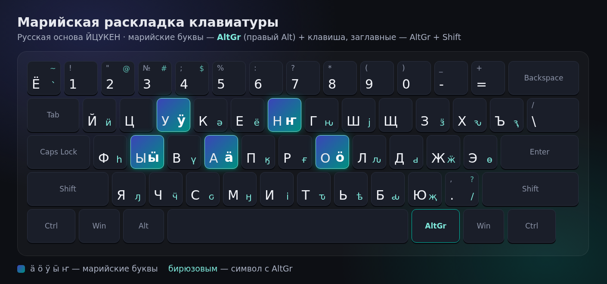
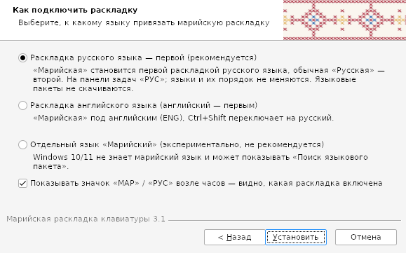

<div align="center">

# ⌨️ Марийская раскладка клавиатуры 3.1

**Марийские буквы ӓ ӧ ӱ ӹ ҥ на обычной русской клавиатуре — для Windows 10 и 11**

[](https://github.com/MihailPirogov/mari-keyboard-windows/releases/latest)
[](https://github.com/MihailPirogov/mari-keyboard-windows/releases)


[**⬇ Скачать установщик**](https://github.com/MihailPirogov/mari-keyboard-windows/releases/latest/download/MariKeyboard-Setup-3.1.exe) · [Страница проекта](https://pirogovlab.ru/mariyskaya-raskladka-klaviatury/)



</div>

## ✨ Возможности

- Основа — привычная русская **ЙЦУКЕН**, ничего переучивать не нужно.
- Марийские буквы — с правым **Alt (AltGr)**: `AltGr + а о у ы н` → **ӓ ӧ ӱ ӹ ҥ**, с Shift — заглавные **Ӓ Ӧ Ӱ Ӹ Ҥ**.
- Работает на Windows 10/11, x86, x64 и ARM64. Языковые пакеты не скачиваются.
- Три режима: первой раскладкой русского языка (рекомендуется), под английским или отдельным языком «Марийский» (экспериментально).
- Свой индикатор **«МАР» / «РУС»** возле часов — видно, какая раскладка включена.
- **Новое:** галочка «Скрыть системный индикатор языка» — остаётся только наш значок, без путаницы.
- Полное удаление через «Программы и компоненты» с возвратом прежних настроек.

## 🍏 macOS

Марийская раскладка 3.1 для macOS — папка [`macos/`](macos/). Марийские буквы через **Option**: `⌥ + У О А Ы Н В` → **ӱ ӧ ӓ ӹ ҥ ү** (с Shift — заглавные).

1. Скачайте [`MariKeyboard-3.1-macOS.zip`](https://github.com/MihailPirogov/mari-keyboard-windows/releases/download/v3.1-macos/MariKeyboard-3.1-macOS.zip) (или с [pirogovlab.ru](https://pirogovlab.ru/mariyskaya-raskladka-klaviatury/#macos)) и распакуйте.
2. Правый клик по `install.command` → «Открыть» — раскладка скопируется в `~/Library/Keyboard Layouts` и включится.
3. Если «Марийская» не появилась в строке меню: выйдите и войдите в систему, затем Настройки → Клавиатура → Источники ввода → «+» → **«Другие»** → «Марийская».
4. Удаление — `uninstall.command`.

Подробно: [macos/README.ru.md](macos/README.ru.md) · [English](macos/README.en.md). Сборка: `python3 tools/gen_mac.py`.

## 📥 Установка

1. Скачайте [`MariKeyboard-Setup-3.1.exe`](https://github.com/MihailPirogov/mari-keyboard-windows/releases/latest) (или с [pirogovlab.ru](https://pirogovlab.ru/mariyskaya-raskladka-klaviatury/)).
2. Запустите, выберите режим и галочки:



3. Если раскладка не появилась сразу — выйдите из системы и войдите снова.

### Тихая установка

```bat
MariKeyboard-Setup-3.1.exe /S /MODE=ru
```

| Ключ | Действие |
|---|---|
| `/S` | тихая установка без окон |
| `/MODE=ru` \| `en` \| `mhr` | под русским (по умолчанию), под английским или отдельным языком |
| `/NOINDICATOR` | не ставить индикатор «МАР / РУС» |
| `/KEEPSYSINDICATOR` | не скрывать системный индикатор языка |

### Индикатор и системный значок

Windows показывает только язык, поэтому «Марийская» и «Русская» обе выглядят как «РУС». Индикатор `MariIndicator.exe` показывает **МАР** (малиновый) или **РУС/ENG** (серый) и запускается вместе с Windows.

Опция «Скрыть системный индикатор языка» (включена по умолчанию вместе с индикатором) для текущего пользователя включает языковую панель рабочего стола (`Set-WinLanguageBarOption -UseLegacyLanguageBar`) и прячет её (`HKCU\Software\Microsoft\CTF\LangBar\ShowStatus = 3`). Прежние значения сохраняются в `HKCU\Software\MariKeyboard\SysIndicator` и возвращаются при удалении. Полностью применяется после повторного входа. Alt+Shift и Win+Пробел работают как раньше.

## 🛠 Сборка из исходников

Нужны Linux, `clang`, `lld`, `llvm` (llvm-rc), `mingw-w64` (i686), `nsis`, Python 3:

```bash
sudo apt install clang lld llvm gcc-mingw-w64-i686 nsis python3
PATH=/usr/lib/llvm-19/bin:$PATH ./build.sh   # → dist/MariKeyboard-Setup-3.1.exe
```

| Папка | Что внутри |
|---|---|
| `src/` | раскладка `kbdmari.c`, `.klc`, ресурсы |
| `tools/` | генератор раскладки, проверка DLL, генерация картинок |
| `indicator/` | индикатор МАР/РУС (Win32, C) |
| `installer/` | NSIS-установщик, `mari-layout.ps1`, справка |
| `res/` | иконки и картинки установщика |

## 🇬🇧 English

**Mari keyboard layout 3.1 for Windows 10/11** (x86/x64/ARM64). Russian ЙЦУКЕН base; Mari letters ӓ ӧ ӱ ӹ ҥ via **AltGr** (+Shift for capitals). Includes a tray indicator showing МАР/РУС and an option to hide the Windows input indicator. Silent install: `MariKeyboard-Setup-3.1.exe /S /MODE=ru|en|mhr [/NOINDICATOR] [/KEEPSYSINDICATOR]`. Build with `./build.sh` (clang + lld + mingw + NSIS).

---

<div align="center">

Автор — **Михаил Пирогов** · [PirogovLab](https://pirogovlab.ru) · продолжение проекта «Марий клавиатур» 3.0

</div>
